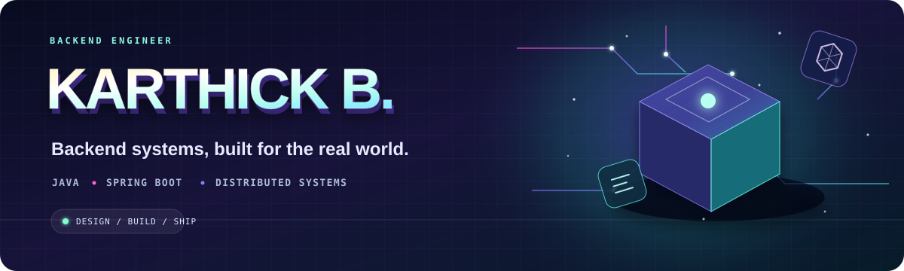
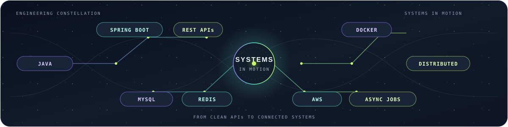

## I build the systems behind the screen.

`JAVA` &nbsp; `SPRING BOOT` &nbsp; `BACKEND ENGINEERING`

I turn requests into results—**one reliable backend at a time.**  
`APIs` &nbsp; `ASYNC WORKFLOWS` &nbsp; `DATA SYSTEMS` &nbsp; `SCALABLE SERVICES`

<a href="mailto:karthickbalaji23@gmail.com">LET’S BUILD SOMETHING</a>
&nbsp;&nbsp;✳&nbsp;&nbsp;
<a href="https://github.com/23-Karthick-B">EXPLORE MY REPOS</a>

---

## `01` &nbsp; THE BUILD LOG

### ⚡ Distributed Code Execution Platform
**From code submission to isolated execution.**

Built an asynchronous, multi-worker backend that runs submitted code inside isolated Docker containers. The platform schedules jobs and tracks execution status and history.

`JAVA` &nbsp; `SPRING BOOT` &nbsp; `DOCKER` &nbsp; `REDIS` &nbsp; `MYSQL`

<table>
<tr>
<td width="50%" valign="top">

### 🧩 Employee Management System
**Role-based workflows for employees and admins.**

Built at **Saksoft**: employees can manage their profiles and download payslips; admins can manage employee records through CRUD workflows.

`JAVA` &nbsp; `SPRING BOOT` &nbsp; `REST API` &nbsp; `MYSQL`

</td>
<td width="50%" valign="top">

### 🍳 AI Cooking Assistant
**Ingredients in. Context-aware recipes out.**

A Spring Boot API pairs ingredient-based recommendations with structured prompts and response validation for AI-generated cooking suggestions.

`JAVA` &nbsp; `SPRING BOOT` &nbsp; `OPENAI` &nbsp; `REACT`

</td>
</tr>
</table>

## `02` &nbsp; THE TOOLKIT

#### ⟡ LANGUAGES

#### ⟡ BACKEND / FRAMEWORKS

#### ⟡ DATA / CACHE

#### ⟡ CLOUD / WORKBENCH

---

### GOOD SYSTEMS ARE QUIET WHEN THEY WORK.
#### CLEAR WHEN THEY DON’T.

<a href="mailto:karthickbalaji23@gmail.com">↗ START A CONVERSATION</a>

